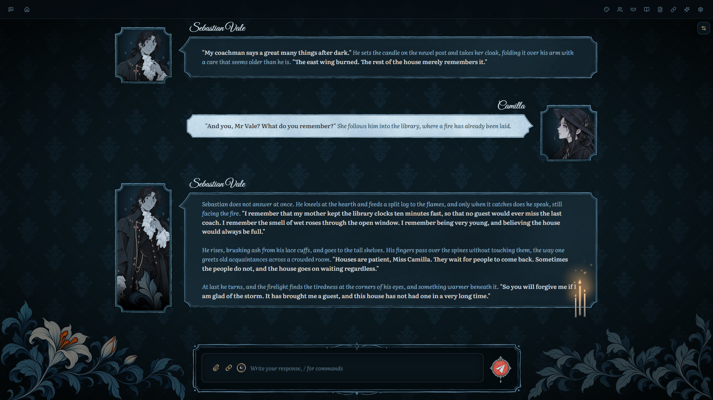
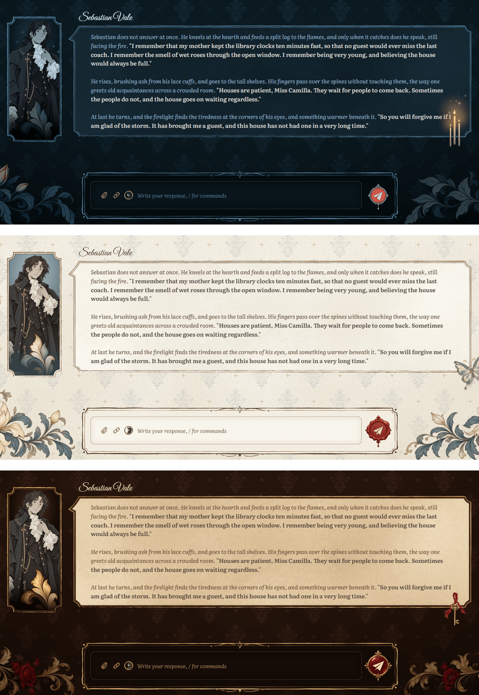
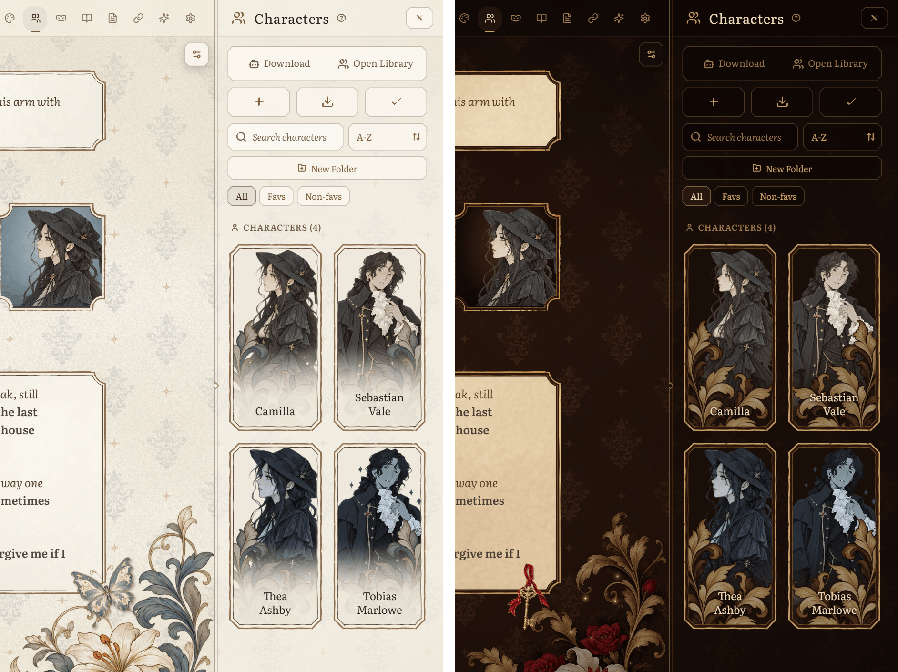
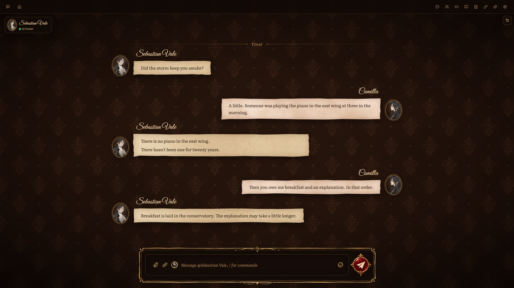
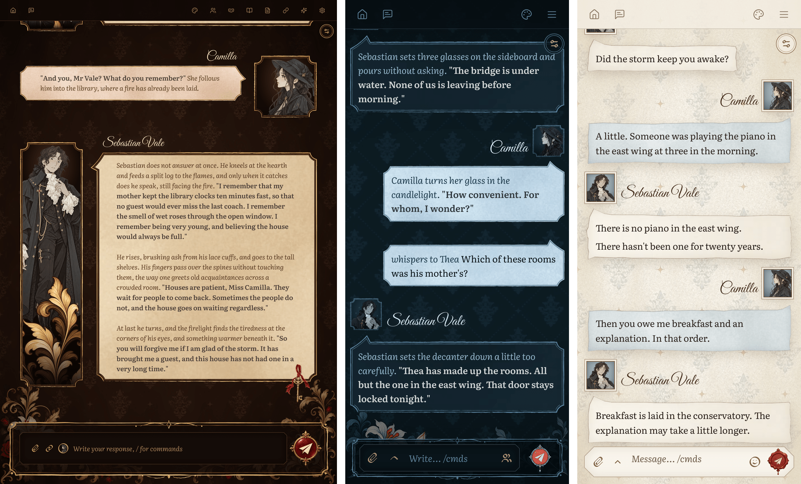
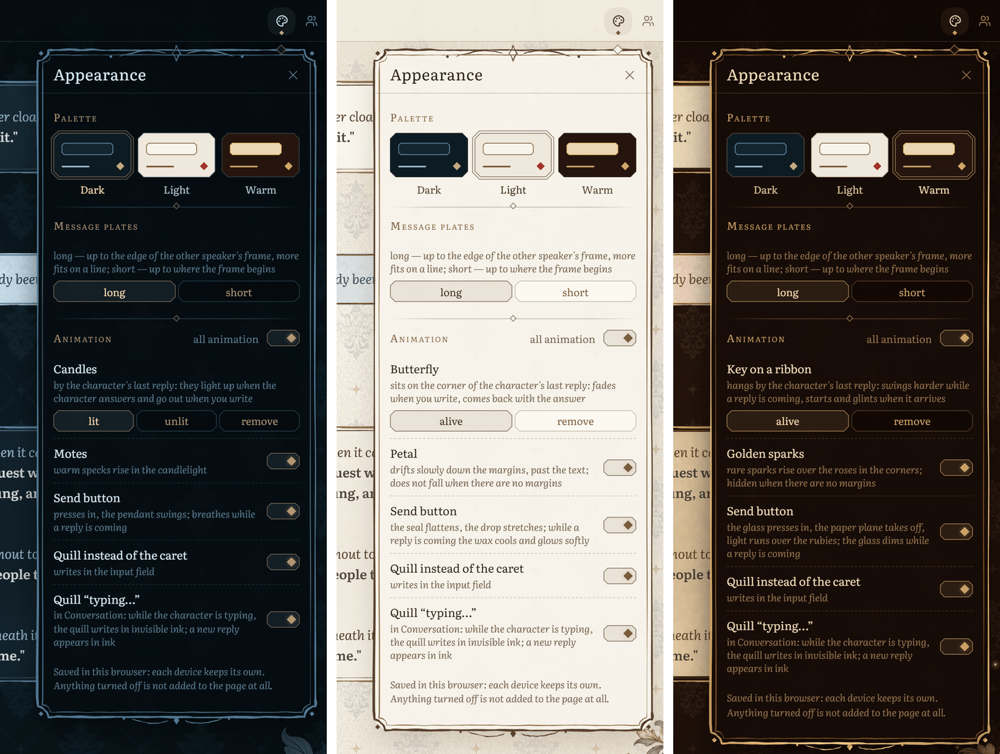

# Damask

A hand-drawn theme for [Marinara Engine](https://github.com/Pasta-Devs/Marinara-Engine) roleplay and
Conversation chats. Watercolour message plates, full-height portrait frames, damask wallpaper, flowers
in the corners and a living quill instead of the text cursor, in three palettes: **dark**, **light**
and **warm**.



> Tested on **Marinara Engine 2.5.0**. Works on desktop, iPad and phones.
> The theme's own menu is in **English and Russian**. По-русски: [README.ru.md](README.ru.md).

## What it does

- **Message plates** painted in watercolour, with a hand-inked border. Each reply gets its own
  patch of paper, so a long scene doesn't look like a stack of identical boxes.
- **Full-height portrait frames** next to each reply. A short line shows the face; a long reply
  reveals the whole figure, always at the same scale.
- **Something alive by the last reply:** three candles in the dark palette (they light up when the
  character answers and blow out when you send), a butterfly in the light one, a key on a velvet
  ribbon in the warm one.
- **On wide screens** the margins come alive too: motes of candlelight, a petal drifting down the
  margin, golden sparks over the roses. They stay in the margins and never cross the text.
- **A living quill** writes where the text cursor would be when you type.
- **A send button for each palette:** a pendant that swings, a wax seal that flattens, a glass
  that dims while the reply is coming.
- **Conversation chats** become letters: each speaker's lines on one sheet of paper, oval
  portraits, a quill that "types" in invisible ink while the character is writing.
- **Panels too:** the chat list, the character cards (portrait cards, two per row on desktop),
  settings and the top bar are dressed to match.

### Three palettes

Dark, light and warm. Switch any time; the choice is remembered in each browser.



### Characters panel

Character cards become portrait cards. Full-length art with a transparent background looks best.



### Conversation mode



### iPad and phones

On the iPad the frames stay full height beside the text. On phones the portrait becomes a small
medallion above each plate, and the plate takes the whole width.



## The Appearance menu

The **palette button** in the top bar opens **Appearance**:

- **Palette:** Dark / Light / Warm.
- **Message plates** (desktop only): *long* plates reach the edge of the other speaker's frame, so
  more text fits on a line; *short* plates stop where that frame begins.
- **Animation:** a switch for all of it at once, and one switch for each piece in the current
  palette (candles can also stay *unlit*). Anything turned off isn't added to the page at all.

Choices are saved in the browser, so your phone and your desktop can each have their own.



## Requirements

- **Marinara Engine 2.5.0** (that's what it was built and tested on).
- **Browsers:** Chrome and Edge on desktop; Safari on Mac, iPad and iPhone (iOS 16.4 or newer);
  Chrome on Android (checked at 360 and 412 px wide).
- Marinara's **light mode** is fine, but while Damask is on, Marinara's own panels and settings stay
  dark (they are drawn for a dark page). Turn Damask off and light mode comes back.

## Install

Damask is an **External Extension with full page access**, so Marinara asks you to unlock
third-party extensions first. You only do this once, from any browser: the extension is stored
on the server, so every device that opens your Marinara gets it.

1. **Allow external extensions on the host.** Open the `.env` file in your Marinara folder
   (on Windows usually `%LOCALAPPDATA%\Marinara-Engine\.env`) and set
   ```
   ENABLE_EXTERNAL_EXTENSIONS=true
   ```
   Add the line if it isn't there. Restart Marinara.
2. **Allow imports in the app.** **Settings → Advanced → Danger Zone**, read the warning, turn on
   **Allow third-party extension imports** and confirm **I Understand, Enable**.
3. **Import.** Download `Damask-1.0.0.personal-extension.zip` from [Releases](../../releases)
   (don't unzip it). **Settings → Addons → External Extensions → Import Extension File** and pick
   the zip. It appears as a disabled draft marked *Needs approval · Full page access*.
4. **Approve.** Press the power icon on its row (**Review and run**) and confirm **Run Exact Code**.
   The theme applies at once, no reload needed.

Using Marinara from a phone or another computer on your network? Managing extensions there also
needs admin access: set `ADMIN_SECRET` on the server and enter the same value under
**Settings → Advanced → Admin Access**.

**Update:** import the new zip the same way and confirm **Save Disabled Update**, then
**Review and run → Run Exact Code** again. Your palette and animation choices are kept.
**Turn off:** the power icon on its row (**Disable**). **Remove:** the trash icon.

## Recommended Marinara settings

- **Settings → Appearance → Roleplay → Roleplay Presentation → Roleplay Avatars: Glued Side Panel.** This is
  the style the full-height frames are built on. *Small Circles*, *Small Rectangles* and *None*
  also work, with smaller portraits. **Scrollable Avatars** can stay on or off.
- **Settings → Appearance → Conversation → Conversation Display → Chat Layout: Linear.** In *Bubbles* the theme
  leaves Conversation chats as plain Marinara.
- **Avatars:** tall portraits (about 2:3) suit the frames. The frame uses the avatar crop you set
  in the character card for the face, then shows the rest of the picture below it as a reply
  gets longer.

## Language

The Appearance menu and the few words the theme adds (Conversation status lines, button labels)
are in English and Russian. The theme follows Marinara's interface language; while Marinara is
set to English (the default), it follows your browser's language instead.

## Works with Offstage

[Offstage](https://github.com/RadaOgrada/Marinara-Offstage) is a side panel for group roleplay
scenes (who's in the room, whispers, emotions, reply mode). In its **Auto** look it follows the
Damask palette: dark, light or warm, and it switches when you switch.

## Why full page access

A theme this detailed can't be done with Marinara's custom CSS alone (that is capped at 256 KB
and sanitised), so Damask runs as page code. What it does:

- Adds its own stylesheet, fonts and pictures, all inside the extension. It loads nothing from
  the internet.
- Reads your characters and personas from your own Marinara (only to know each avatar's crop).
- Adds a few small elements of its own: the palette button and its menu, the candles / butterfly /
  key, the margin animations, the quill in the input field.
- Remembers the palette, plate length and animation switches in your browser's `localStorage`.

It doesn't change messages, characters or settings. **Disable** puts the page back as it was,
without a reload.

## Licence

- **Code:** [MIT](LICENSE).
- **Fonts:** Literata (The Literata Project Authors) and Great Vibes (The Great Vibes Pro Project
  Authors), both under the SIL Open Font License: [OFL-Literata.txt](OFL-Literata.txt),
  [OFL-GreatVibes.txt](OFL-GreatVibes.txt).

## Credits

- Icons: some outlines come from [Lucide](https://lucide.dev) (ISC), redrawn with a broad-nib pen.
- The characters in the screenshots, Sebastian Vale and Camilla, were made for the theme's
  mock-ups; the chats are written for these screenshots.
