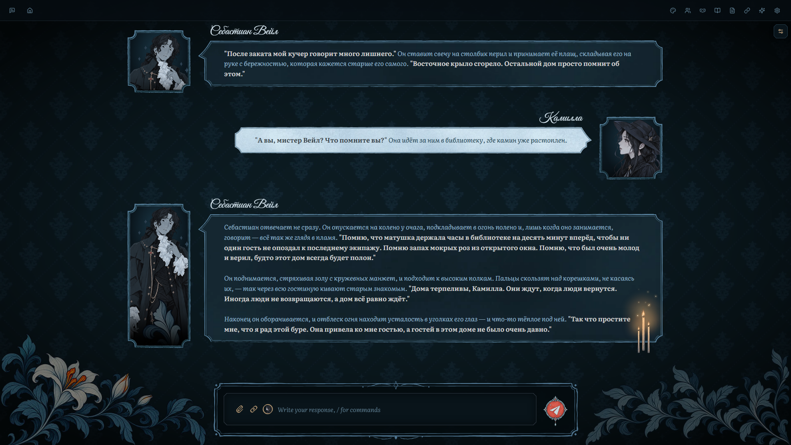
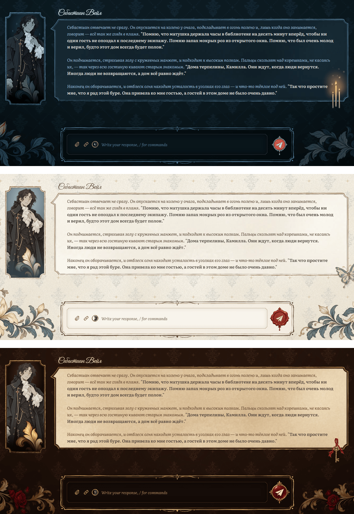
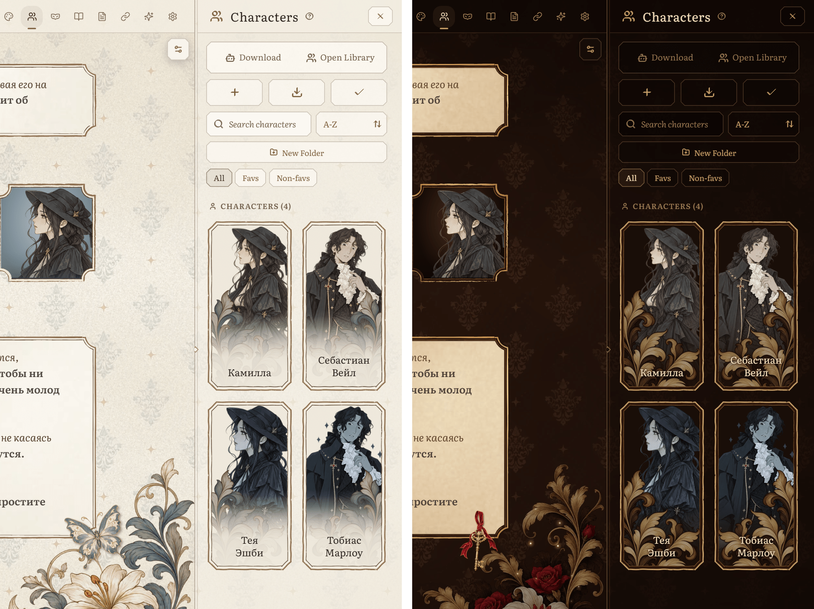
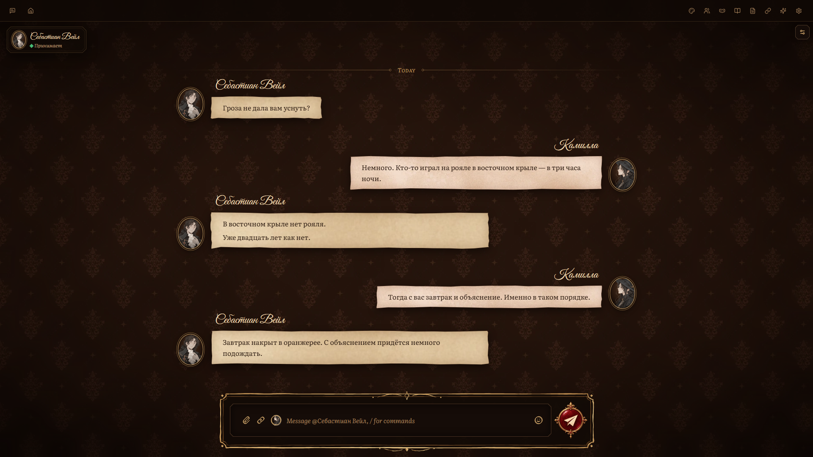
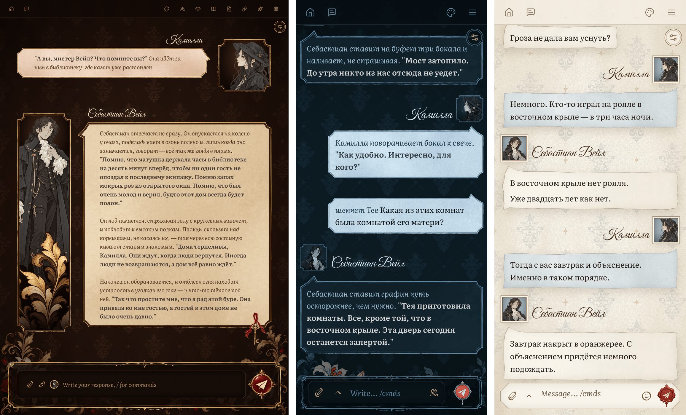
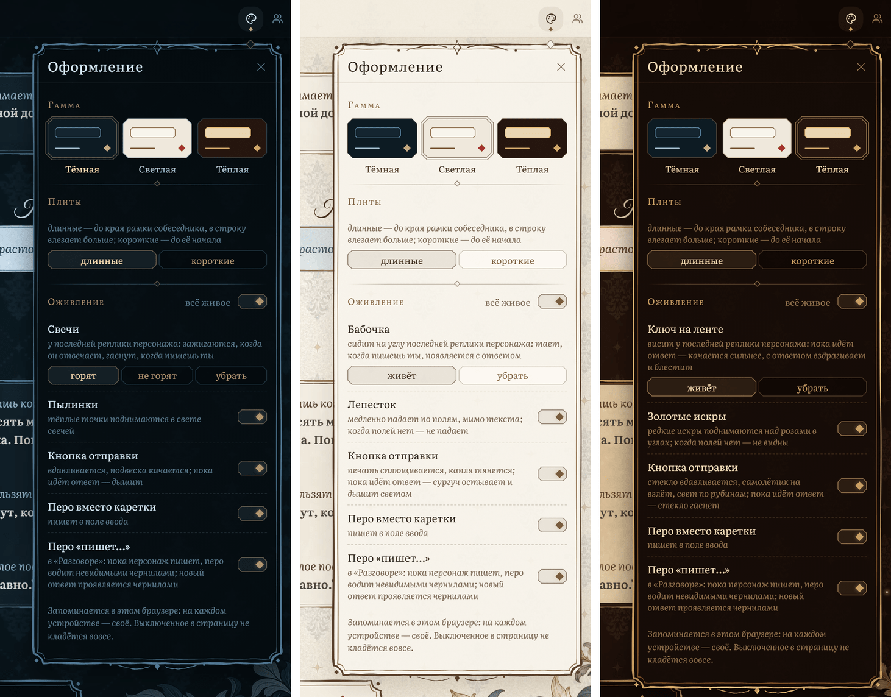

# Damask

Рисованная тема для ролевых чатов и «Разговора» в [Marinara Engine](https://github.com/Pasta-Devs/Marinara-Engine).
Акварельные плашки реплик, портреты в рост в резных рамках, обои-дамаск, цветы по углам и живое перо
вместо курсора. Три гаммы: **тёмная**, **светлая** и **тёплая**.

> Сделано и проверено на **Marinara Engine 2.5.0**. Компьютер, айпад, телефон.
> Меню темы — на русском и английском. English version: [README.md](README.md).

## Что внутри

- **Плашки реплик** — акварель с рамкой, нарисованной от руки. У каждой реплики свой кусок
  бумаги, поэтому длинная сцена не превращается в стопку одинаковых коробок.
- **Портрет в рост** рядом с репликой. На короткой реплике видно лицо, на длинной — фигуру
  целиком, масштаб при этом не меняется.
- **У последней реплики что-то живёт:** в тёмной гамме три свечи (загораются, когда персонаж
  отвечает, и гаснут, когда пишешь ты), в светлой — бабочка, в тёплой — ключ на бархатной ленте.
- **На широком экране** оживают и поля: пылинки в свете свечей, лепесток, золотые искры над
  розами. Только на полях, через текст не идут.
- **Живое перо** пишет там, где был бы курсор.
- **Своя кнопка отправки в каждой гамме:** подвеска качается, сургучная печать сплющивается,
  стекло гаснет, пока идёт ответ.
- **«Разговор»** становится перепиской: реплики одного собеседника — на одном листе, портреты
  в овальных рамках, а пока персонаж «печатает», перо пишет невидимыми чернилами.
- **Панели тоже:** список чатов, карточки персонажей (портретные, по две в ряд на компьютере),
  настройки и верхняя полоса — в том же стиле.

### Три гаммы

Тёмная, светлая и тёплая. Переключаются в любой момент, выбор запоминается в браузере.

### Панель персонажей

Карточки становятся портретами. Лучше всего смотрятся рисунки в рост на прозрачном фоне.

### «Разговор»

### Айпад и телефон

На айпаде рамки остаются в рост рядом с текстом. На телефоне портрет превращается в медальон над
плашкой, а сама плашка — во всю ширину.

## Меню «Оформление»

Кнопка с палитрой в верхней полосе открывает **«Оформление»**:

- **Гамма:** тёмная / светлая / тёплая.
- **Плиты** (только на компьютере): *длинные* доходят до рамки собеседника, в строку влезает
  больше; *короткие* заканчиваются там, где рамка начинается.
- **Оживление:** общий переключатель и по одному на каждую анимацию текущей гаммы (свечи можно
  оставить *незажжёнными*). Выключенное вообще не добавляется на страницу.
- **Шрифт:** *Дамаск* (Literata) или *Маринара* (шрифт интерфейса твоей маринары) — для текста
  реплик, поля ввода и панелей. Имена в любом случае остаются прописью Дамаска.

Выбор хранится в браузере: на телефоне и на компьютере он может быть разным.

## Что нужно

- **Marinara Engine 2.5.0.**
- **Браузеры:** Chrome и Edge на компьютере; Safari на Mac, iPad и iPhone (iOS 16.4 и новее);
  Chrome на Android (проверено на ширине 360 и 412 px).
- **Светлый режим** маринары можно не выключать, но пока Damask включена, панели и настройки самой
  маринары остаются тёмными (они нарисованы под тёмную страницу). Выключите Damask — светлый режим вернётся.

## Как поставить

Damask — внешнее расширение с полным доступом к странице, поэтому маринара сначала просит
разрешить сторонние расширения. Ставится один раз из любого браузера: расширение хранится на
сервере, и его получают все устройства, которые открывают твою маринару.

1. **Разреши внешние расширения на сервере.** В файле `.env` в папке маринары (на Windows обычно
   `%LOCALAPPDATA%\Marinara-Engine\.env`) поставь `ENABLE_EXTERNAL_EXTENSIONS=true` (нет строки —
   допиши) и перезапусти маринару.
2. **Разреши импорт в самой маринаре.** **Settings → Advanced → Danger Zone** → включи
   **Allow third-party extension imports** → **I Understand, Enable**.
3. **Импорт.** Скачай `Damask-1.1.0.personal-extension.zip` из [Releases](../../releases), не
   распаковывай. **Settings → Addons → External Extensions → Import Extension File** → выбери
   архив. Появится выключенный черновик с пометкой *Needs approval · Full page access*.
4. **Одобри.** Кнопка питания в его строке (**Review and run**) → **Run Exact Code**. Тема
   включится сразу, перезагружать страницу не нужно.

Ставишь с телефона или с другого компьютера в сети? Тогда нужен ещё `ADMIN_SECRET` на сервере и
то же значение в **Settings → Advanced → Admin Access**.

**Обновление:** импорт нового архива → **Save Disabled Update** → **Review and run** →
**Run Exact Code**. Гамма и настройки оживления сохраняются. **Выключить** — кнопка питания
(**Disable**), **удалить** — корзина в строке расширения.

## Настройки маринары

- **Settings → Appearance → Roleplay → Roleplay Presentation → Roleplay Avatars: Glued Side Panel.** На этом
  стиле держится вся тема: портреты в рост в рамках рядом с репликами. *Small Circles* (у маринары
  по умолчанию), *Small Rectangles* и *None* работают, но аватар там маленький и стоит в стороне
  от реплики — тема его только аккуратно оформляет. **Scrollable Avatars** — как удобнее.
- **Settings → Appearance → Conversation → Conversation Display → Chat Layout: Linear.** В режиме *Bubbles* тема
  оставляет «Разговор» обычным, как в маринаре.
- **Аватары:** рамкам подходят высокие портреты (примерно 2:3). Лицо берётся из кропа аватара
  в карточке персонажа, а чем длиннее реплика, тем больше видно ниже.
- **Settings → Appearance → App Style → Chat widget style** (и его Font, Shape, Colors), пока Damask
  включена, не действует: окна и кнопки тема рисует сама. Твой выбор сохраняется и вернётся,
  когда выключишь Damask.

## Язык

Меню «Оформление» и немногие слова, которые добавляет тема (статусы в «Разговоре», подписи
кнопок), — на русском и английском. Тема берёт язык интерфейса маринары; пока маринара на
английском (так по умолчанию) — язык браузера.

## Вместе с Offstage

[Offstage (Кулисы)](https://github.com/RadaOgrada/Marinara-Offstage) — панель для групповых сцен:
кто в комнате, шёпот, эмоции, режим ответа. В виде **«Авто»** она подстраивается под гамму
Damask и переключается вместе с ней.

## Зачем полный доступ к странице

Такую подробную тему не сделать одним CSS маринары (там предел 256 КБ и санитайзер), поэтому
Damask работает как код страницы. Что он делает:

- добавляет свой стиль, шрифты и картинки — всё лежит внутри расширения, из интернета ничего
  не грузится;
- читает персонажей и персон из твоей же маринары — только чтобы знать кроп аватаров;
- добавляет свои мелкие элементы: кнопку с палитрой и меню, свечи / бабочку / ключ, анимации на
  полях, перо в поле ввода;
- пока включена, откладывает на странице стиль виджетов маринары (саму настройку не трогает);
- запоминает гамму, длину плит, шрифт и переключатели оживления в `localStorage` браузера.

Сообщения, персонажей и настройки он не меняет. **Disable** возвращает страницу как была, без
перезагрузки.

## Лицензия

- **Код:** [MIT](LICENSE).
- **Шрифты:** Literata (The Literata Project Authors) и Great Vibes (The Great Vibes Pro Project
  Authors), оба под SIL Open Font License: [OFL-Literata.txt](OFL-Literata.txt),
  [OFL-GreatVibes.txt](OFL-GreatVibes.txt).

## Спасибо

- Часть значков — контуры [Lucide](https://lucide.dev) (ISC), перерисованные широким пером.
- Себастиан Вейл и Камилла на скриншотах сделаны для макетов темы; переписка написана
  специально для скриншотов.
